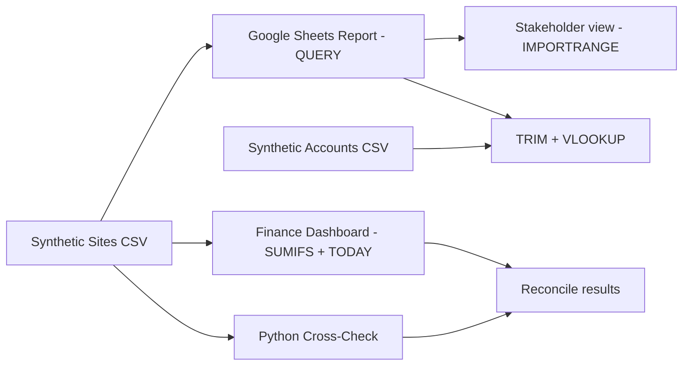

# Multi-Site Operations & Finance Tracker

**Python • Google Sheets • Financial Reporting • Data Cleaning**

A hands-on portfolio project that tracks site completion, missing client invoices, pending partner payments, and time since survey assignment.

> **Privacy:** All 16 sample sites, values and accounting records are fictional. This is an independent practice project; it contains no employer-provided assessment PDFs, original company datasets, or confidential information.

## Business problem

Operations teams working across many sites need quick answers:

- Which **completed** jobs do not have invoice numbers?
- How much client billing is associated with those jobs?
- How much is pending for service partners?
- Which sites have waited longest since survey assignment?
- How can the same report be shared automatically without copy-paste?

## Example dashboard

Results for the fictional sample data, based on the rules documented in the project:

| Metric | Sample result |
| --- | ---: |
| Completed sites, invoice missing — client amounts | **₹196,550** |
| Missing-invoice records whose payment status indicates invoicing/payment | **₹114,000** |
| Completed sites, partner payment pending | **₹121,400** |

**Important:** The second result is a **data-quality flag**, not proof of cash received. Payment-status labels may not match actual bank transactions.

## Architecture



## Repository files

| Path | Why it matters |
| --- | --- |
| [data/sample_sites.csv](data/sample_sites.csv) | 16 original synthetic operations records |
| [data/sample_accounts.csv](data/sample_accounts.csv) | Synthetic lookup data with intentional extra spaces/case differences |
| [analytics.py](analytics.py) | Calculates metrics using Python's standard library |
| [tests/test_analytics.py](tests/test_analytics.py) | Five automated checks |
| [docs/google_sheets_formulas.md](docs/google_sheets_formulas.md) | Complete copyable Google Sheets formulas and setup instructions |
| [docs/data_dictionary.md](docs/data_dictionary.md) | Field definitions, assumptions and limitations |

## Run the project

Requires **Python 3.10+** and no external packages.

```bash
python analytics.py
python -m unittest discover -s tests -v
```

The amount totals stay the same for the original dataset; **days since assignment** changes based on today's date.

## What this demonstrates

1. **Data reporting:** Use `QUERY` to build a live report from operational records.
2. **Data sharing:** Use `IMPORTRANGE` for a stakeholder view with appropriate access controls.
3. **Data cleaning:** Use `TRIM`, `VLOOKUP`, exact matching, and fixed reference ranges.
4. **Financial logic:** Use `SUMIFS` to calculate amounts according to explicit business conditions.
5. **Automation:** Use `ARRAYFORMULA` and `TODAY()` for site aging.
6. **Validation:** Compare formulas against independently implemented Python totals and automated tests.

## Example interview explanation

> I built a small operations-finance reporting example using fictional site records. I defined the business rules for outstanding invoices and partner payments, implemented the formulas in Google Sheets, and used Python to cross-check the totals. I also included tests for invoice changes and data-cleaning cases.

## Next steps

- Add duplicate-name and invoice validation checks.
- Join records by a unique Site ID instead of a free-text site name.
- Add a chart by city and work status.
- Build a simple Streamlit interface after validating the spreadsheet model.

## Development note

This is an independent educational portfolio exercise with AI-assisted scaffolding/review. The data, calculations, and tests are public so that all results can be reproduced and understood.
